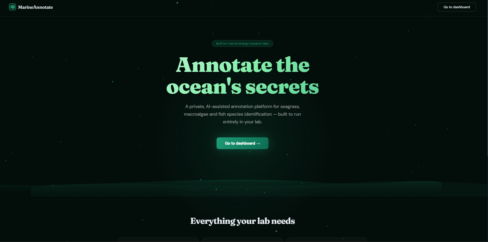
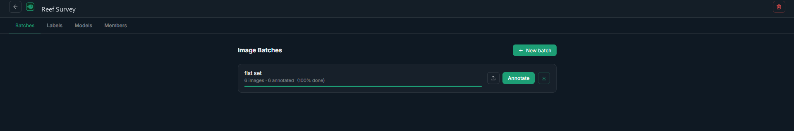
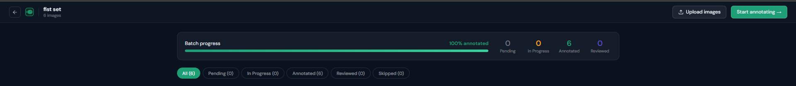
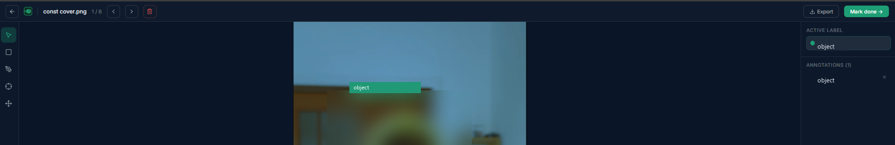

# MarineAnnotate

[](https://github.com/DolapoSalim/marineAnnotate/actions/workflows/backend-tests.yml)

In-house annotation platform for underwater marine imagery — seagrasses, macroalgae, and fish species.

## Features

- **Bounding box, polygon, keypoint & classification** annotation tools
- **AI-assisted labelling** — upload any YOLO model, run inference on unannotated images, review/edit/accept/reject suggestions
- **Editable AI predictions** — drag handles directly on canvas to correct slightly off predictions before accepting
- **Real-time collaboration** — WebSocket-based live sync; multiple lab members can work simultaneously
- **Admin console** — create/manage lab accounts, assign roles (admin / reviewer / annotator)
- **Project & batch management** — organise images into projects and batches, assign images to team members
- **Export** — COCO JSON, YOLO TXT (zip), Pascal VOC (zip), CSV
- **Annotation history** — every change is tracked with full rollback capability
- **Image enhancement** — brightness/contrast controls (Phase 2)

---

## Screenshots

| | |
|---|---|
|  |  |
|  |  |

---

## Quick Start (Local Dev)

### Prerequisites
- Python 3.11+
- Node.js 20+
- PostgreSQL 14+ running locally (`marine` user, `marine_annotate` database)

### 1. Start PostgreSQL

```bash
createuser -s marine
createdb -O marine marine_annotate
```

Or with Docker:
```bash
docker run -d --name marine-pg \
  -e POSTGRES_USER=marine -e POSTGRES_PASSWORD=marine -e POSTGRES_DB=marine_annotate \
  -p 5432:5432 postgres:16-alpine
```

### 2. Launch everything

```bash
chmod +x start.sh
./start.sh
```

Open **http://localhost:5173** — default login: `admin@lab.local` / `changeme123`

---

## Docker Compose (Recommended for Lab Server)

This is the setup a new lab follows end-to-end, on their own server, the first time they deploy.
`.env` files hold real secrets and are never committed to git — each lab creates its own from the
`.env.example` templates below and fills in its own values locally.

```bash
git clone <this repo>
cd marineAnnotate

# Copy the two env templates:
cp backend/.env.example backend/.env       # app config (SECRET_KEY, SMTP, admin account, etc.)
cp .env.example .env                       # Postgres/Redis passwords (repo root)
```

Now edit both files:

**`backend/.env`** — at minimum, set:

- `SECRET_KEY` — generate one, never leave the placeholder: `python -c "import secrets; print(secrets.token_urlsafe(48))"`
- `FIRST_ADMIN_EMAIL` / `FIRST_ADMIN_PASSWORD` — becomes the very first admin account, auto-created
  on first boot. Use a strong password here — there's currently no in-app "change my own password"
  option, only the email-based forgot/reset flow, so whatever you set here (or later reset it to) is
  what sticks.
- `APP_URL` — the real address your team will reach it at (e.g. `https://lab.example.org`), **not**
  `localhost` if this is a shared server. This gets embedded in every invite/reset email link. Use
  `https://` and drop the port once you've enabled TLS (see below) — Caddy serves on the standard
  443 port.
- `SMTP_*` — optional, but without it invite/reset links only print to `docker compose logs backend`
  instead of emailing. Worth configuring before onboarding real people (see the SMTP note in
  [SECURITY.md](SECURITY.md) for the Gmail App Password setup used during development).

**`.env`** (repo root) — generate strong values for `POSTGRES_PASSWORD` and `REDIS_PASSWORD`:

```bash
python -c "import secrets; print(secrets.token_urlsafe(24))"
```

Then build and start:

```bash
docker compose up --build -d
open http://localhost:5173   # or your server's address
```

Log in with the `FIRST_ADMIN_EMAIL`/`FIRST_ADMIN_PASSWORD` you set above — see
[Inviting Lab Members](#inviting-lab-members) below for onboarding the rest of the team.

Images and models persist in `./storage/` on the host. Postgres and Redis are not exposed to the
host network — only the `backend` container can reach them — so `POSTGRES_PASSWORD`/`REDIS_PASSWORD`
only need to be strong, not memorable. For admin access to the database directly, use
`docker compose exec db psql -U marine marine_annotate` rather than exposing the port.

The command above (`docker compose up`) runs everything over plain HTTP on `localhost:5173` — fine
for local testing on one machine. Before a real lab uses this for real work, see **HTTPS / TLS**
below — it's one flag away, not a separate setup.

---

## HTTPS / TLS

Plain HTTP means passwords and session tokens cross the network unencrypted — fine on `localhost`,
not fine the moment this is reachable by anyone else. A TLS-terminating reverse proxy ([Caddy](https://caddyserver.com/))
is built in and disabled by default; enable it with one extra flag:

```bash
docker compose --profile tls up -d --build
```

Set `DOMAIN` in the root `.env` first:

- **Real public domain** (e.g. `lab.example.org`) pointed at this server's IP → Caddy automatically
  gets and renews a real Let's Encrypt certificate. Nothing else to configure.
- **`localhost` or a bare IP** (internal-network-only lab, no public domain) → Caddy automatically
  falls back to a locally-trusted self-signed certificate instead. Browsers show a one-time warning
  until you trust Caddy's local root CA (or just click through — normal for internal tools).

Once enabled, Caddy becomes the only network-facing entrance — the `backend` (`:8000`) and
`frontend` (`:5173`) ports are bound to `127.0.0.1` only, so they're reachable for local debugging
on the server itself but not from anywhere else, and there's no way to accidentally bypass HTTPS.

If you're on an internal-only network and don't want to deal with certificates at all, a tunnel like
[Tailscale](https://tailscale.com/) or a Cloudflare Tunnel is a reasonable alternative to the Caddy
profile — see [Remote Team Access](#remote-team-access) below.

---

## Remote Team Access

TLS (above) covers *encryption*. It doesn't cover *reachability* — a lab member outside your local
network still can't reach `https://your-server` unless something makes that address actually
resolve to your machine from the internet. Where your team is decides what you need:

- **Same machine, or same office/lab network** — nothing extra. Set `APP_URL` in `backend/.env` to
  `http://localhost:5173` (same machine) or this server's LAN IP (same network), and invites work
  as-is.
- **Remote / different location** — you need one of the options below. Don't use router
  port-forwarding for this on a personal/lab workstation: it exposes the machine directly to the
  whole internet, and most ISPs' CGNAT makes it impossible anyway.

**Cloudflare Tunnel** (built in, disabled by default) makes an *outbound* connection to Cloudflare —
no router changes, works even behind CGNAT, and nothing needs installing on your lab member's end.

```bash
docker compose --profile tunnel up -d
./scripts/get-tunnel-url.sh   # prints the address once it's up
```

- **No setup, right now**: the command above gets you a free, instant `*.trycloudflare.com` address.
  Good enough to unblock a remote invite today — but Cloudflare gives it no uptime guarantee, and
  **the address changes** if this container ever restarts.
- **Stable, permanent address**: create a named tunnel in the [Cloudflare Zero Trust
  dashboard](https://one.dash.cloudflare.com/) (free account + a domain you own), set `TUNNEL_TOKEN`
  in the root `.env` to the token it gives you, then use the other profile instead:
  `docker compose --profile tunnel-named up -d`.

Either way, once you have the address: set it as `APP_URL` in `backend/.env`, then
`docker compose up -d --force-recreate backend` so new invite links use it. The Admin Console warns
you directly if `APP_URL` still points at `localhost`/a private address when you send an invite —
see [Inviting Lab Members](#inviting-lab-members).

**Alternative — [Tailscale](https://tailscale.com/):** every collaborator installs Tailscale and
joins your private network. More setup per person than a tunnel, but nothing is ever exposed to the
public internet at all — a better fit if remote access becomes a standing pattern with the same
people, rather than one-off invites.

---

## API Docs

Auto-generated OpenAPI docs available at **http://localhost:8000/docs** — only when `DEBUG=true` in
`backend/.env` (disabled by default, since exposing them is a minor information leak on a real
deployment). Set `DEBUG=true` locally if you want to browse them.

---

## Testing

A backend test suite (auth, sessions, permissions) runs automatically on every push/PR via GitHub
Actions — see the badge at the top of this file. To run it locally against disposable, throwaway
Postgres/Redis containers (never the real dev stack's data):

```bash
pip install -r backend/requirements-test.txt   # once
./scripts/run-tests.sh                         # spins up test DB/Redis, runs pytest, tears down
```

Pass extra args straight through to pytest, e.g. `./scripts/run-tests.sh -k test_login -v`.

---

## Project Structure

```
marineAnnotate/
├── backend/
│   ├── app/
│   │   ├── core/          # Config, DB, security
│   │   ├── models/        # SQLAlchemy ORM models
│   │   ├── schemas/       # Pydantic V2 schemas
│   │   ├── crud/          # Database operations
│   │   ├── routers/       # FastAPI route handlers
│   │   │   ├── auth.py
│   │   │   ├── users.py
│   │   │   ├── projects.py
│   │   │   ├── images.py
│   │   │   ├── annotations.py
│   │   │   ├── ai.py       # Model upload + inference jobs
│   │   │   ├── export.py   # COCO/YOLO/VOC/CSV export
│   │   │   └── websocket.py
│   │   ├── services/
│   │   │   ├── inference.py  # YOLO inference pipeline
│   │   │   └── websocket.py  # WS connection manager
│   │   └── main.py
│   ├── requirements.txt
│   └── Dockerfile
│
├── frontend/
│   ├── src/
│   │   ├── api/           # Axios API client
│   │   ├── components/
│   │   │   ├── canvas/    # Konva annotation canvas
│   │   │   └── sidebar/   # AI review panel
│   │   ├── hooks/         # useWebSocket
│   │   ├── pages/         # Login, Dashboard, Project, Annotate, Admin
│   │   ├── store/         # Zustand stores (auth, canvas, project)
│   │   └── types/         # TypeScript types
│   └── Dockerfile
│
├── docker-compose.yml
├── start.sh
└── README.md
```

---

## AI-Assisted Labelling Workflow

1. **Annotate** a subset of images manually (e.g. 50 of 200)
2. **Export** as YOLO format and train your model externally (YOLOv9/v11)
3. **Upload** the trained `.pt` model in Project → Models tab
4. **Map** YOLO class IDs to your label classes (JSON mapping)
5. **Run AI assist** on a batch — inference runs on a separate Celery worker (the `celery_worker`
   service, started automatically with `docker compose up`), not inside the API process, so one
   inference job no longer blocks the app for everyone else while it runs
6. **Review** — each prediction shown with confidence; drag handles to correct, then accept/reject
7. **Retrain** on the growing confirmed set to improve the model iteratively

---

## Keyboard Shortcuts (Annotation Editor)

| Key | Action |
|-----|--------|
| `B` | Bounding box tool |
| `P` | Polygon tool (double-click to close) |
| `K` | Keypoint tool |
| `V` | Select tool |
| `H` | Pan tool |
| `←` / `→` | Previous / next image |
| `+` / `-` | Zoom in / out |
| `Del` / `Backspace` | Delete selected annotation |
| `A` | Accept AI suggestion (in review panel) |
| `R` | Reject AI suggestion |

---

## Roles

| Role | Can do |
|------|--------|
| **Admin** | Everything + create/manage users |
| **Reviewer** | Annotate + approve/reject annotations |
| **Annotator** | Annotate images in assigned projects |

---

## Inviting Lab Members

There's no public sign-up page — accounts are always admin-invited. This is deliberate: nothing
about this app should be reachable by someone who wasn't given access on purpose.

1. Log in as an admin and open the **Admin Console**.
2. Click **Invite member**, fill in their name, email, and role, and send.
3. They receive an email with a link (or, if SMTP isn't configured yet, an admin fetches the link
   from `docker compose logs backend` — it's printed there as a fallback).
4. They open the link, set **their own password** (the admin never sees or sets it), and can log in
   immediately.
5. Platform account access and project access are separate steps. To get them working on a specific
   project, open that **Project → Members** and add them from the member list — they need an
   account first (steps 1–4) before they can be added to any project.

Every invite sent, and every account created, role change, or disable/enable, is recorded in the
**Activity log** in the Admin Console — see [SECURITY.md](SECURITY.md) for what else is logged.

---

## Data & Privacy

MarineAnnotate is self-hosted — everything below lives on **your own server**, under **your own
control**. Nothing is sent to the project's maintainers or any third party.

**Personal data stored about your team:**

- Name, email address, and role for each user account
- Login timestamps (`last_login`)
- Who created/edited/reviewed each annotation, and a full edit history per annotation

**Where it lives:** the Postgres database and the `storage/` directory on whichever machine you
deploy this to. If you configure SMTP for invite/reset emails, those emails (containing a name and
email address) pass through whatever mail server you point `SMTP_HOST` at.

**Your responsibility as the operator:** if your team includes people in the EU/UK, running this
app for them makes your lab a data controller under GDPR for the account data above — you're the
one who decides how long it's retained and who can delete it (an admin can deactivate an account
via the Admin console; there's no self-service "delete my account" flow yet). See
[SECURITY.md](SECURITY.md) for hardening a deployment beyond `localhost`.

---

## Backups

Nothing is backed up automatically — set this up before you have real project data on it.

```bash
# One-off backup (dumps the database + archives storage/ into ./backups/)
./scripts/backup.sh

# Restore from a backup (DESTRUCTIVE — overwrites current data)
./scripts/restore.sh backups/db_20260821_020000.sql.gz backups/storage_20260821_020000.tar.gz
```

Schedule `backup.sh` to run nightly with cron (Linux/Mac) or Windows Task Scheduler. It keeps the
last 14 backups of each kind and deletes older ones — adjust `KEEP` in the script if you want more
history. Copy the `backups/` directory offsite periodically (a local backup on the same disk as the
database doesn't protect you from disk failure).

---

## License & Citation

MIT licensed — see [LICENSE](LICENSE). Free to use, fork, and self-host, including for other labs.

If MarineAnnotate is used in published research, please cite it — see [CITATION.cff](CITATION.cff)
(GitHub renders a ready-to-copy citation for this automatically via the "Cite this repository"
button on the repo page).
